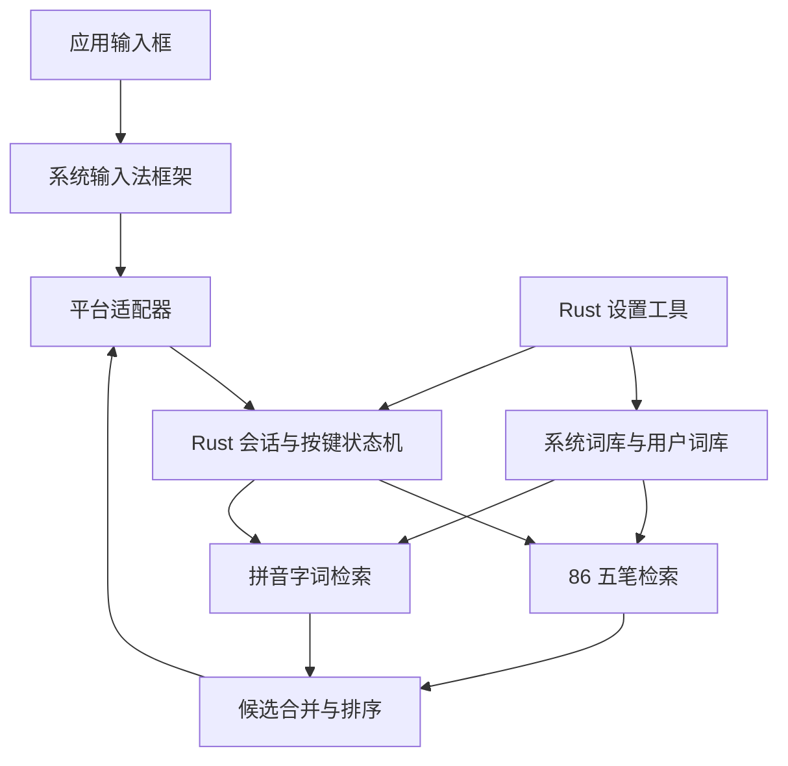

# 芝麻输入法：Rust 跨平台设计方案

> 产品名称：芝麻输入法 · Zhima IME；工程目录：`zhima-ime`。
>
> 本文是已确认的目标设计，包含尚未实现的能力，不代表当前版本已经完成验收。实际完成情况与缺口见 [实现状态](status.md)，已执行的检查见 [验证记录](verification.md)。

## 1. 产品目标与首版范围

面向 **86 五笔熟练用户**，提供五笔主用、拼音辅助、三端行为一致的桌面输入法。核心引擎使用 Rust 自研，自研代码采用 Apache-2.0，免费开源。

首版采用直接混输：同一编码同时查询五笔和拼音，**五笔精确匹配优先，默认手动确认上屏**。

| 能力 | 首版设计 |
|---|---|
| 五笔输入 | 86 五笔单字、简码、词语、编码补全、固定码序 |
| 拼音辅助 | 全拼字词、多音字、末音节补全、五笔编码提示 |
| 输入模式 | 五笔拼音混输、纯五笔、纯拼音、英文 |
| 上屏操作 | 空格确认、数字选词、翻页；纯五笔可开启四码唯一自动上屏、五码顶屏 |
| 用户词库 | 自定义短语、手动造词、候选置顶、删除用户词、导入导出 |
| 日常设置 | 中英文标点、全半角、候选数量、字体、横竖排、明暗主题 |
| 隐私 | 本地处理、本地存储；诊断日志仅包含状态和性能信息 |

搜狗五笔的混输、自定义短语及候选设置作为交互参考。[搜狗官方帮助](https://wubi.sogou.com/help.php)

整句预测、模糊音、双拼、云同步、皮肤市场、语音及 AI 功能列入后续版本。

首版支持范围：

- **macOS 14+**：Apple Silicon、Intel。
- **Windows 11 x64**：同时支持 64 位和 32 位应用。
- **Linux x64**：Ubuntu 24.04 LTS、Debian 13；提供 Fcitx 5、IBus 适配，验收 X11 与 Wayland。

## 2. 系统架构与接口

采用“**共享引擎库＋平台适配器＋独立设置工具**”，候选内容和输入规则由 Rust 引擎统一决定，窗口定位与文本提交交给平台适配器。

### 模块职责

使用一个 Cargo workspace，划分为以下模块：

| 模块 | 职责 |
|---|---|
| `ime-core` | 会话状态机、按键处理、模式切换、候选合并、上屏决策 |
| `ime-wubi` / `ime-pinyin` | 两种编码的独立检索与解析 |
| `ime-dictionary` | 词库编译、索引、反查、版本与来源管理 |
| `ime-userdata` | 用户词、置顶、拼音使用频次、配置持久化 |
| `ime-ffi` | 原生适配层调用的稳定 C ABI |
| `ime-settings` | 基于 egui/eframe 的三端设置和词库管理工具 |
| 平台适配模块 | 系统注册、焦点、文本组合、候选窗口、安装与卸载 |

egui/eframe 用于设置窗口；输入过程中的候选窗口使用平台原生能力。[egui 项目说明](https://github.com/emilk/egui)

### 平台接入

| 平台 | 实现方式 |
|---|---|
| Windows | 使用 `windows-rs` 实现 TSF COM DLL；x86/x64 薄前端连接同一用户的 Rust 引擎服务，集中管理词库与会话 |
| macOS | Objective-C 薄接入层实现 InputMethodKit 控制器，通过 C ABI 调用 Rust；使用 AppKit 候选窗口 |
| Linux／Fcitx 5 | C++ 薄插件通过 C ABI 调用 Rust，复用框架候选面板 |
| Linux／IBus | C/GObject 薄接入层通过 C ABI 调用 Rust，复用 IBus 候选面板 |

Windows 当前开发实现使用 C++/Win32 COM 薄前端和 Rust 命名管道服务，与上表 `windows-rs` 的目标选型存在差异；两种位数的前端共用引擎协议和 Rust 会话规则。安装及实际应用兼容性仍需验收，详见 [Windows 开发版](windows.md)。

这些接入方式分别基于官方的 [TSF](https://learn.microsoft.com/en-us/windows/win32/tsf/text-services-framework)、[InputMethodKit](https://developer.apple.com/documentation/inputmethodkit/imkinputcontroller)、[Fcitx 5 插件接口](https://fcitx-im.org/wiki/Develop_an_simple_input_method/en)及 [IBusEngine](https://ibus.github.io/docs/ibus-1.5/IBusEngine.html)。

### 核心接口约定

- `Session`：对应一个系统输入上下文，保存模式、编码串、选中候选及配置快照；不同输入框之间隔离组合状态。
- `test_key`：只判断是否处理按键，不修改会话。Windows 的 `OnTestKeyDown` 调用此接口，避免试探事件造成重复输入。[微软接口说明](https://learn.microsoft.com/en-us/windows/win32/api/msctf/nf-msctf-itfkeyeventsink-ontestkeydown)
- `process_event`：处理按键、候选选择、焦点和模式事件，返回按键是否被消费、预编辑文本、候选快照及提交动作。
- `Candidate`：包含会话内标识、文本、来源、匹配类型和五笔编码提示。
- `ack_commit`：平台确认提交成功后，才更新使用频次；提交失败不计入学习。
- FFI 使用不透明句柄和明确的释放接口；Rust panic、原生异常均在边界内处理。

Windows IPC 使用带版本号、请求序号的本地命名管道，限制当前用户访问；提交请求不自动重放。服务失联时结束当前组合并放行后续按键，防止阻塞应用。

## 3. 输入规则与词库设计

### 混输与按键规则

默认候选顺序为：

**用户显式置顶 → 五笔精确匹配 → 拼音完整字词 → 五笔补全 → 拼音末音节补全。**

同一文本去重并合并来源标记。五笔候选保持词库中的稳定码序，拼音候选在同组内结合基础词频和本地使用频次排序。

- 混输模式允许超过四码，关闭四码自动上屏及五码顶屏。
- 纯五笔模式提供上述上屏选项，默认关闭；五码顶屏仅在前四码存在候选时提交首选，再处理第五键。
- 空编码时输入反引号进入临时拼音；选词后返回原模式，候选附带五笔编码。
- 空格提交当前候选；没有候选时提交原始编码及空格。
- Enter 提交原始编码；Esc 清空组合；Backspace 删除编码，空组合时交还应用。
- Shift 单独轻按切换中英文；有组合时先提交原始编码。快捷键组合不触发切换。
- 默认每页 5 个候选，可设置为 3–9 个；支持数字选择、方向键及 PageUp/PageDown。
- 焦点离开时取消尚未提交的组合，防止编码进入另一个输入框。

### 五笔与拼音算法

**五笔采用码表检索，不在首版推导字形拆分。** 将编码建立为静态前缀索引，同时维护汉字到规范全码的反向索引。

手动造词使用规范全码：两字各取前两码；三字取第一字首码、第二字首码、第三字前两码；四字及以上取前三字与末字的首码。缺少规范全码时提示用户补充编码。

拼音使用音节 Trie 构建切分路径，再查询字词索引：

- 支持连续全拼及撇号分隔，处理 `xian` 与 `xi'an` 等歧义。
- 支持 `v` 表示 `ü`，按照标准拼写规范化。
- 多条合法切分路径同时检索，合并结果。
- 首版输出词库中的单字或词语，不进行跨词整句生成。
- 编码串上限为 64 个字符，并限制切分路径数量，保证处理时间有界。

### 数据与持久化

- 五笔基线采用 [rime-wubi](https://github.com/rime/rime-wubi)，保留 LGPL-3.0 及作者声明；拼音基线采用 Apache-2.0 的 [rime-pinyin-simp](https://github.com/rime/rime-pinyin-simp)。
- 词库编译器将源数据转换为版本化只读索引，并随包提供来源、原始数据、转换说明和许可证。
- 编译时检查编码合法性、重复项、规范全码、索引边界及校验值；相同输入产生相同产物。
- 用户词、置顶和拼音频次使用 SQLite；配置使用带版本号的 TOML。
- 按键处理读取内存快照，持久化由后台执行；配置和词库在组合结束后切换。
- 支持项目 TSV 格式，以及 Rime YAML 词典数据子集的导入导出；导入前展示预览、冲突和错误行。

## 4. 验证与交付

按四个阶段推进，每阶段同时维护三端适配：

1. **基础闭环**：固定词库快照、接口和按键回放夹具；三端均完成输入、候选、提交、取消和焦点切换。
2. **核心能力**：完成五笔、拼音、混输排序、反查、造词及用户数据。
3. **产品体验**：完成设置工具、词库迁移、原生候选窗口、安装、升级和卸载。
4. **发布验收**：完成兼容测试与性能测量，同步发布三个平台的安装包。

关键验收场景：

- **编码正确性**：基线词库逐条精确检索通过；简码、词码、反查及造词结果符合固定夹具。
- **混输正确性**：同码冲突、重复候选、长拼音、跨四码输入均不产生提前提交。
- **平台一致性**：相同词库、配置与事件序列产生相同引擎结果；TSF 试探事件不改变状态。
- **应用兼容性**：浏览器、Office／LibreOffice、VS Code、终端，以及 Windows 32 位应用；Linux 分别验证 GTK、Qt、XWayland 与原生 Wayland。
- **窗口与隐私**：多显示器、缩放、全屏、屏幕边缘、焦点切换；平台标记的敏感字段交还系统，日志检查无输入正文。
- **故障恢复**：引擎服务退出、数据库只读、损坏词库、导入中断、升级失败，验证无重复提交且仍可使用键盘。
- **性能目标**：Release 构建、词库预热后，核心处理 P95 ≤2 ms，按键回调至候选更新请求 P95 ≤16 ms。以上是设计预算，报告须附测试硬件和词库规模。

正式发行提供 Windows 签名安装包、macOS 签名及公证安装包、Linux 分发行版 DEB 包；升级保留用户数据，并提供配置和数据库迁移回退方案。

## 5. 假设与默认约定

- 项目名称为“芝麻输入法 · Zhima IME”，工程名为 `zhima-ime`。
- 首版默认简体中文、完全离线，更新通过用户主动下载安装包完成。
- Weasel 用于参考 Windows 前端、服务与引擎的职责划分；自研代码独立实现。其仓库采用 GPLv3。[Weasel 说明](https://github.com/rime/weasel)
- 词库授权独立于自研代码授权管理，发布物保留各自声明。
- 类型、函数及关键逻辑使用中文文档注释；日志和用户可见错误使用中文。
- 设计、接口和验收文档统一使用 Markdown；首版发布条件是三平台全部通过验收。

### 本次重命名的兼容约定

本次变更更新产品名称、工程目录、界面标题、C 头文件名及 macOS 标识。现有 `ime-*` crate 名称、`zf_*` C ABI、内部类型与 `ZFIM` 词典格式保持兼容。

macOS 应用包名称为 `芝麻输入法.app`，可执行文件为 `Zhima`，Bundle ID 与输入源 ID 均为 `org.zhima.inputmethod`，连接名为 `ZhimaConnection`。开发包是否完成签名、安装与真实输入验收，以实现状态和验证记录为准。
